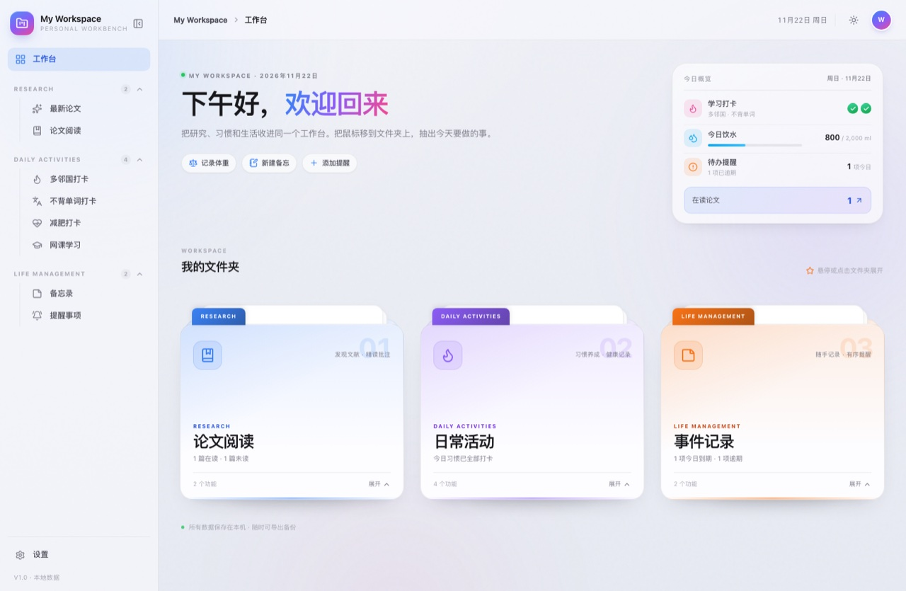
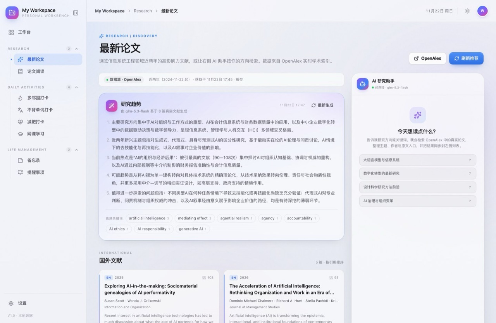
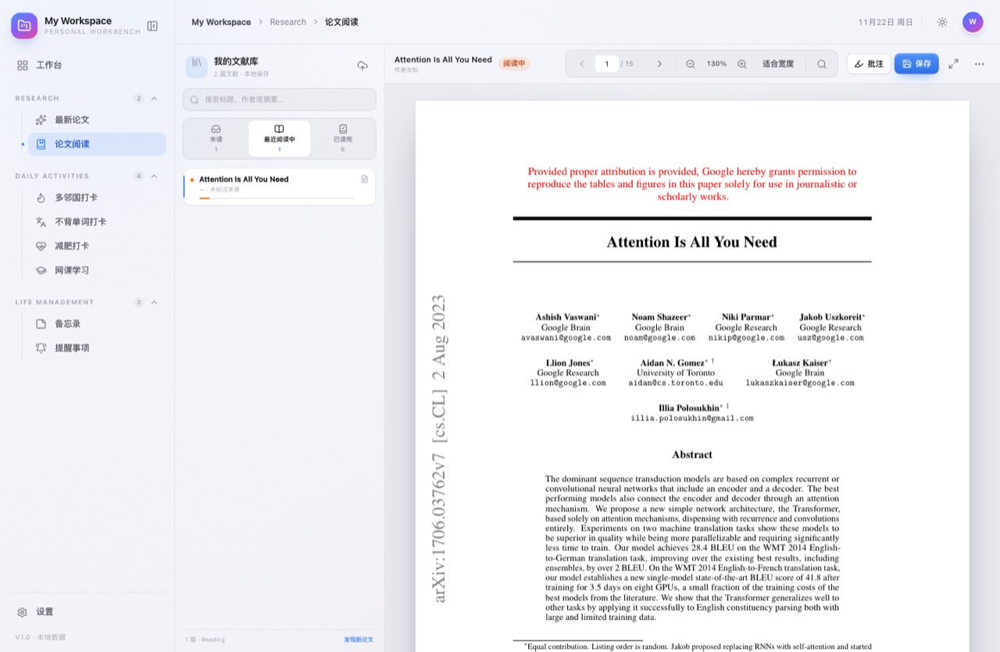
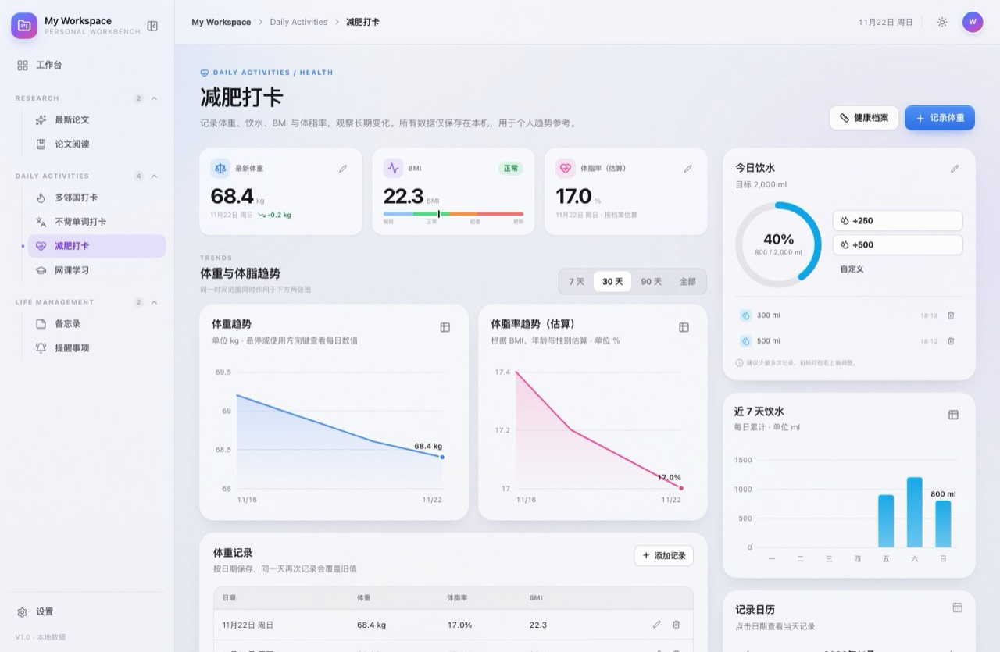
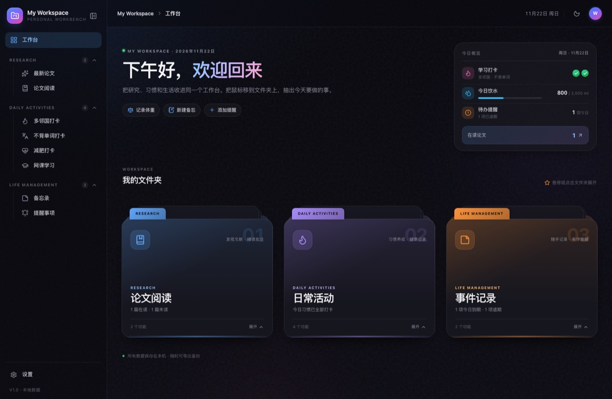

# My Workspace

一个面向个人研究、学习与生活管理的本地桌面工作台。以立式文件夹、毛玻璃视觉和 Light / Night 双主题为核心，把论文阅读、每日习惯、健康记录、网课、备忘与提醒收进同一个空间。



## 功能模块

### 论文阅读 Research

- **最新论文**：从 OpenAlex 实时检索信息系统工程领域近两年的核心期刊文献；右侧 AI 研究助手支持自然语言检索、论文整理和结果同步。
- **论文阅读**：未读 / 最近阅读中 / 已读完三档文件夹；PDF 阅读、翻页、缩放、适合宽度、全文搜索、文本选中高亮、批注、页面笔记、阅读进度持久化。
- 支持上传 PDF、DOCX、旧版 DOC、Markdown、TXT；DOCX / Markdown 在线阅读。
- 开放获取论文可一键抓取 PDF 原文。

### 日常活动 Daily Activities

- **多邻国打卡 / 不背单词打卡**：月历打卡、连续天数、最长连续、累计天数、学习备注、最近记录；单词卡支持释义揭示、随机切换和浏览器朗读。
- **减肥打卡**：首次填写性别、生日、年龄与身高；体重、BMI、体脂率（按公式估算）与饮水目标；多次饮水记录、趋势曲线、7 天柱状图、记录日历、历史表格与数据表视图。
- **网课学习**：课程文件夹、资料上传与管理、Markdown 笔记自动保存、学习日历、学习时长和进度记录。

### 事件记录 Life Management

- **备忘录**：Markdown 编辑与预览、自动保存、置顶、搜索、创建时间记录。
- **提醒事项**：截止日期与具体时间、优先级、分类、逾期提示、完成归档与恢复、快速添加。

### 全局

- 文件夹悬停抽取 / 展开动画，点击可固定展开（适合触屏）。
- 左侧树状导航，可收起、可移动端抽屉。
- Light / Night / 跟随系统三种外观。
- 本地 SQLite 数据持久化，JSON 一键导出备份。
- 桌面优先，平板与手机基础适配。

## 截图

| 最新论文 + AI 助手 | PDF 阅读与批注 |
| --- | --- |
|  |  |

| 健康仪表盘 | 夜览模式 |
| --- | --- |
|  |  |

## 快速开始

环境要求：**Node.js ≥ 22.5**（使用内置 `node:sqlite`），推荐 Node 24+。本项目开发环境为 Node 26。

```bash
npm install
cp .env.example .env
# 可选：编辑 .env，填入 ZHIPU_API_KEY
npm run dev
```

首次进入「减肥打卡」会引导填写性别、生日、年龄和身高，用于自动计算 BMI 与体脂率。

打开 <http://localhost:5173>。

- `npm run dev` 同时启动 Vite（5173）和本地 API（127.0.0.1:8787）。
- 不配置智谱 API Key 也可以使用全部本地功能和 OpenAlex 检索；AI 面板会降级为直接检索真实文献。
- 首次打开「最新论文」会实时请求 OpenAlex，可能需要几秒。

### 配置智谱 AI（可选）

1. 在 [智谱开放平台](https://open.bigmodel.cn/) 获取 API Key。
2. 在项目根目录 `.env` 中填写：

```env
ZHIPU_API_KEY=你的密钥
# 可选，默认 glm-5.3-flash
ZHIPU_MODEL=glm-5.3-flash
```

3. 重启 `npm run dev`。

API Key 只存在于服务端环境变量，不会写入前端代码、浏览器存储或 Git。

### OpenAlex（可选）

```env
OPENALEX_API_KEY=
OPENALEX_MAILTO=you@example.com
```

免费 Key 可提高每日检索额度。未配置时同样可用，但共享公共额度。

## 生产运行

```bash
npm run build
npm start
```

打开 <http://127.0.0.1:8787>。Express 会同时提供前端静态文件、SPA 路由、API 和 PDF.js 的本地字体 / CMap 资源。

## 数据与备份

- 数据库：`data/workbench.db`（SQLite，WAL 模式）
- 上传文件：`data/uploads/`
- 备份：设置页「导出 JSON 备份」，或直接访问 `/api/export`（不含上传的原始文件）
- 重置：停止服务后删除整个 `data/` 目录，重启会自动重建数据库并写入内置单词卡

数据默认只保存在本机，应用绑定 `127.0.0.1`，没有账户系统和多设备同步。

## 第三方数据说明

- **OpenAlex** 提供论文元数据、作者机构、引用次数与开放获取链接。国内文献按作者机构所在国（中国）筛选，涵盖中英文发表成果；OpenAlex 对中文期刊近两年的收录有限，因此国内条目可能以英文发表为主。界面中已明确说明。
- 引用次数、摘要等为检索时刻的元数据快照，不保证实时准确。
- 所有 AI 趋势总结只基于检索到的真实文献生成；未配置 AI 时显示关键词统计，不伪造研究结论。

## 项目结构

```text
.
├── server/                  # Express API
│   ├── routes/              # papers / discovery / ai / habits / health / courses / memos / reminders / files / settings / export
│   ├── services/            # OpenAlex、智谱 AI
│   ├── db.js                # node:sqlite schema、迁移与种子数据
│   └── index.js             # 服务入口、PDF.js 资源、静态站点
├── src/
│   ├── components/          # 布局、通用 UI、图表、PDF 阅读器、论文组件
│   ├── pages/               # 工作台、论文、日常活动、事件记录、设置
│   ├── app/                 # 主题、Toast、确认对话框
│   ├── lib/                 # API 客户端、React Query hooks、格式化与导航
│   ├── styles/              # 设计 token、布局、组件与页面样式
│   └── types.ts
├── scripts/smoke.mjs        # 只读 API 冒烟测试
├── docs/screenshots/        # README 截图
├── PRD.md                   # 产品需求文档
├── TECHNICAL_DESIGN.md      # 技术方案
├── TASKS.md                 # 开发任务与状态
└── TEST_REPORT.md           # 测试报告
```

## 常用命令

| 命令 | 作用 |
| --- | --- |
| `npm run dev` | 启动开发环境（Vite + API） |
| `npm run build` | TypeScript 检查并构建前端到 `dist/` |
| `npm start` | 以生产模式启动 Express（需先 build） |
| `npm run smoke` | 对运行中的 API 做只读冒烟测试 |
| `npm run smoke -- --online` | 额外测试 OpenAlex 实时检索 |

```bash
# 生产实例在 8790 时
API_BASE=http://127.0.0.1:8790 npm run smoke -- --online
```

## 安全与隐私

- 单用户本地应用，无登录、无遥测、无云端上传。
- API Key 仅从 `.env` 读取，不通过前端传输。
- 上传文件使用随机存储名，按数据库 ID 提供下载，避免路径遍历。
- 文件上传限制 50MB，论文仅允许 PDF / Word / Markdown / TXT；DOCX/HTML/Markdown 内容在浏览器端经过 DOMPurify 清洗。
- 远程 PDF 抓取限制协议、大小与内网地址，并校验最终跳转地址。
- 不要把 `127.0.0.1:8787` 直接暴露到公网；如需公网使用，请自行增加认证与 HTTPS 反向代理。

## 已知限制

- 智谱 AI 已在本机使用 `glm-5.3-flash` 实测工具调用与趋势生成；如更换模型或账户额度变化，需要在设置页 / `.env` 中调整 `ZHIPU_MODEL` 并重新验证。
- 体脂率使用简化公式估算，仅用于个人趋势观察，不构成医疗或健身诊断。
- 旧版 `.doc` 使用文本提取而非精确保留排版；Word / Markdown 暂不支持划词高亮（可添加页面笔记）。
- 课程资料按文件逐个上传，暂不保留整文件夹的子目录结构。
- 课程笔记与资料目前共享同一课程空间，未建立「笔记 → 具体资料」的显式附件关联。
- 提醒事项目前为应用内逾期提示，未接入系统通知。
- 无数据导入、云同步和移动端 App 封装。

更多细节见 [PRD.md](PRD.md)、[TECHNICAL_DESIGN.md](TECHNICAL_DESIGN.md)、[TEST_REPORT.md](TEST_REPORT.md)。
