# My Workspace · 产品展示

> **Personal Life & Research Management System**  
> 一个本地优先的个人研究、学习与生活管理工作台。文件夹式桌面交互、毛玻璃视觉、Light / Night 双主题，数据保存在本机。

以下截图使用演示数据，图片位于 [`docs/screenshots/`](docs/screenshots/)。

---

## 1. 桌面工作台

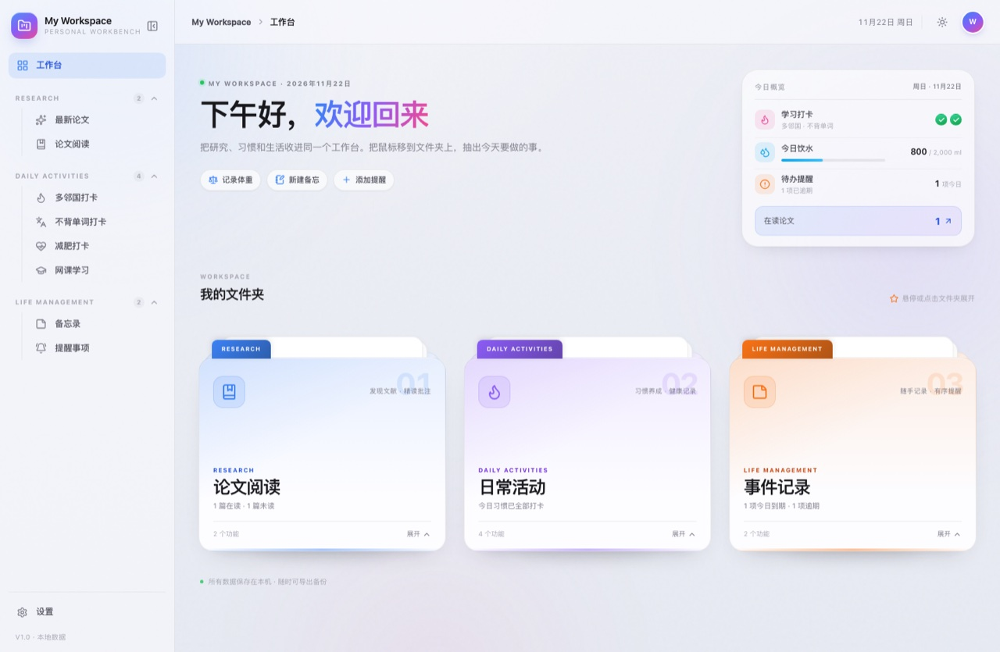

问候语、今日概览与三个立式文件夹。文件夹悬停时抽取展开子功能，点击可固定展开，适配触屏。

| 文件夹抽取 / 展开 | 夜览模式 |
| --- | --- |
| 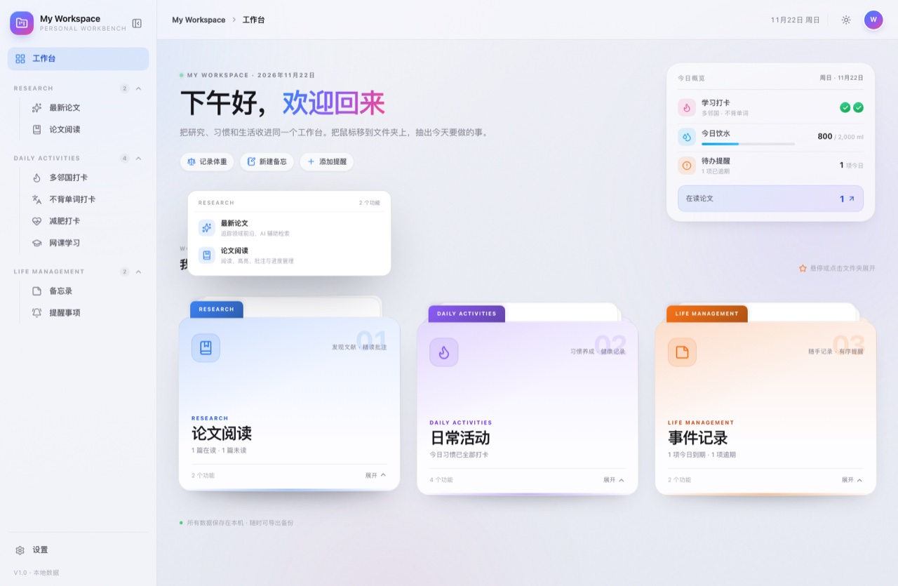 | 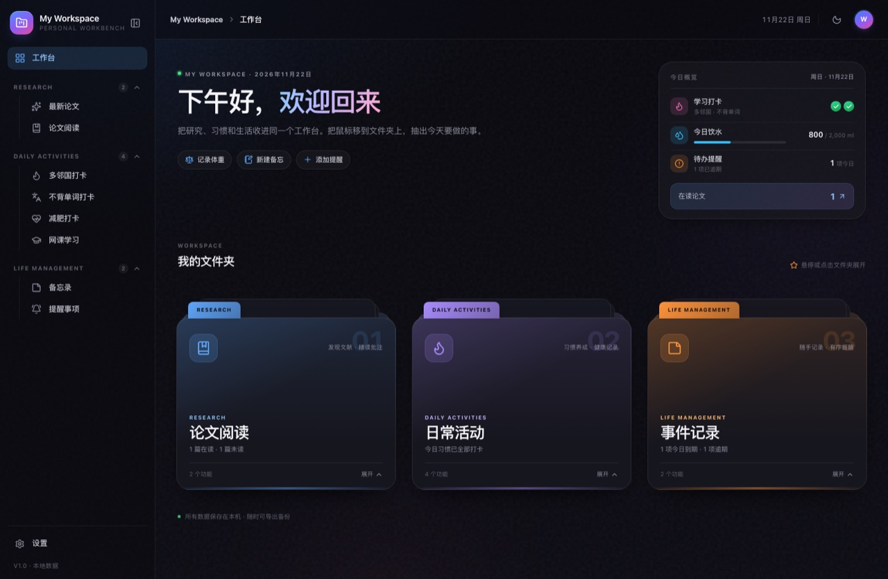 |

---

## 2. 论文阅读

| 最新论文 + AI 研究助手 | PDF 阅读与批注 |
| --- | --- |
| 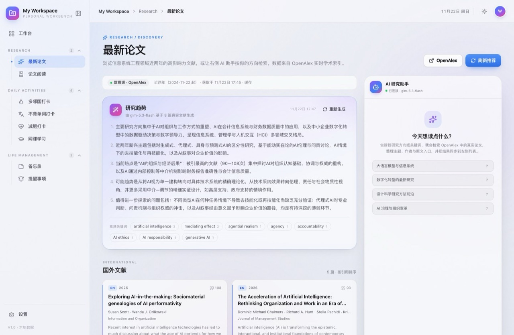 | 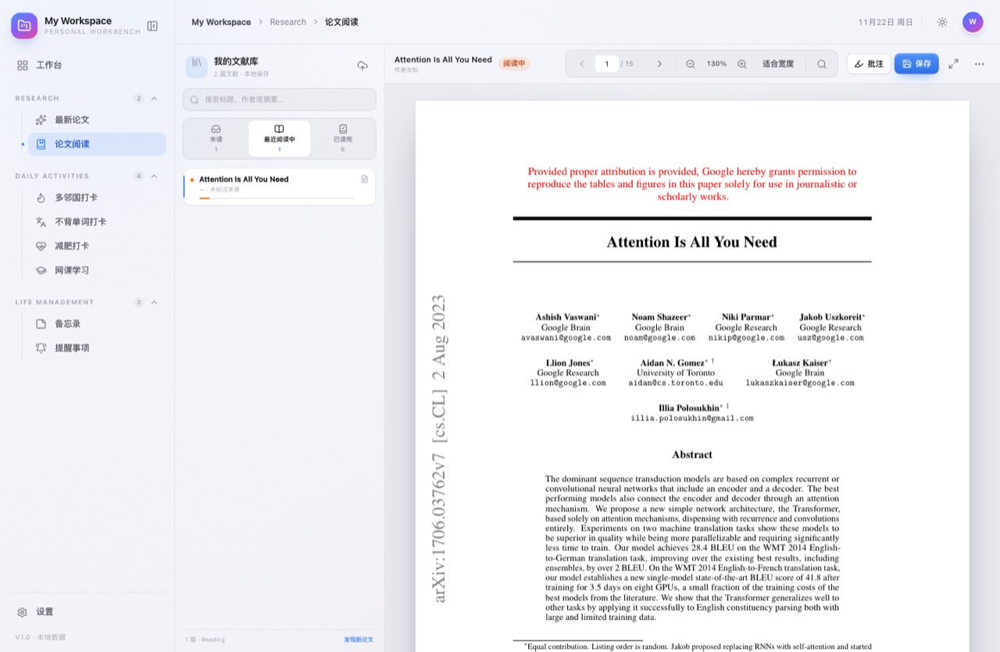 |

- OpenAlex 实时推荐 + 关键词趋势；配置智谱 AI 后可生成中文研究趋势总结。
- 右侧 AI 助手支持自然语言检索，结果同步到左侧论文列表。
- 三档阅读文件夹：未读 / 最近阅读中 / 已读完。
- PDF 翻页、缩放、适合宽度、全文搜索、全屏、划词高亮、批注、页面笔记与阅读进度恢复。
- 支持 DOCX、Markdown 在线阅读和开放获取 PDF 抓取。

---

## 3. 日常活动

| 多邻国打卡 | 不背单词打卡 |
| --- | --- |
| 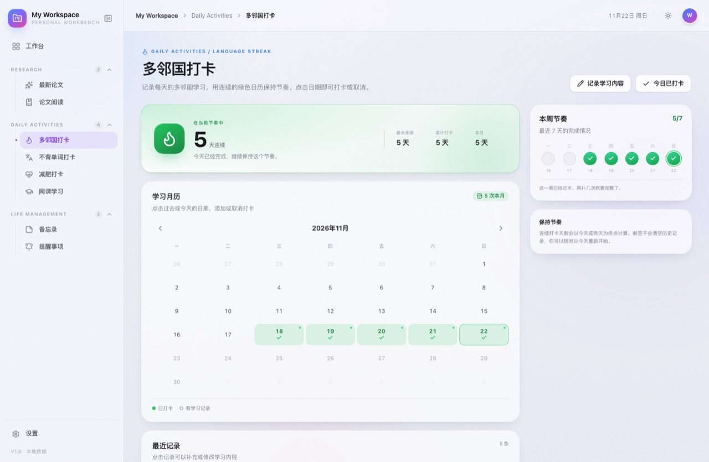 | 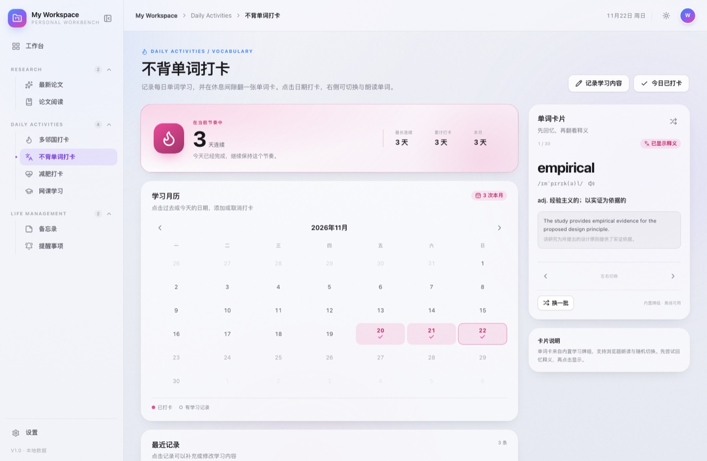 |

月历打卡、连续天数、本周节奏与学习备注；单词卡支持释义揭示、随机切换和朗读。

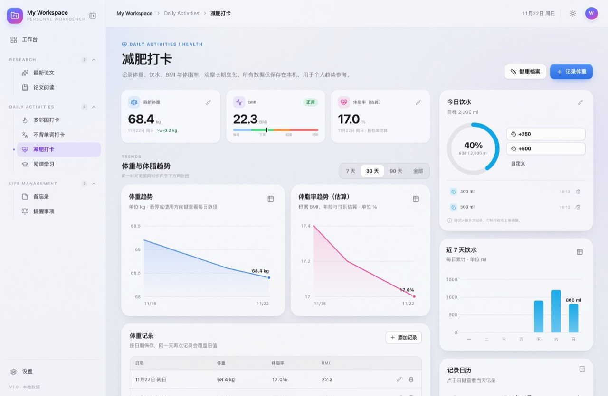

- 首次填写性别、生日、年龄、身高，自动计算 BMI 与体脂率。
- 体重、饮水、体脂趋势与记录日历。
- 图表支持悬停读数、键盘操作与数据表视图。

| 网课列表 | 课程笔记 |
| --- | --- |
| 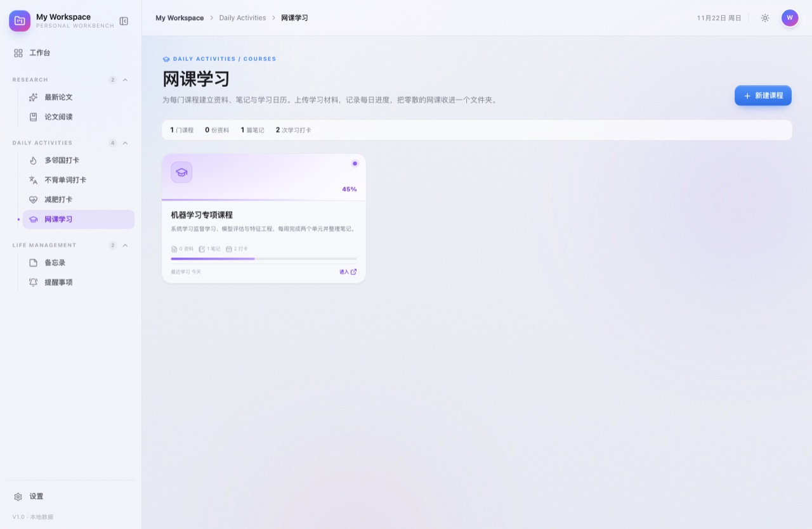 | 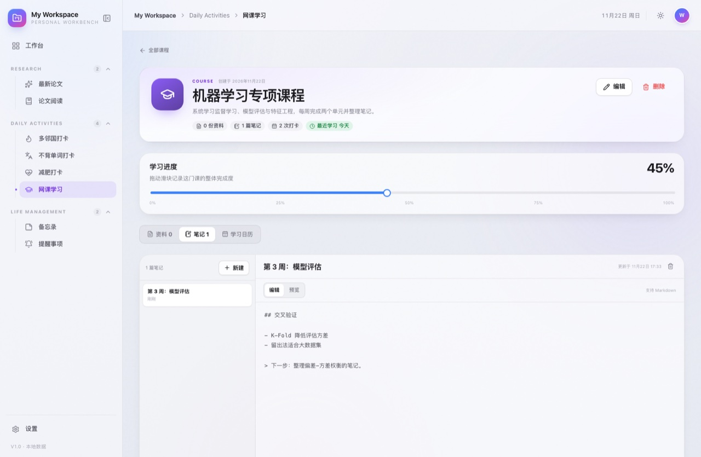 |

课程资料上传、Markdown 笔记自动保存、学习日历与整体进度。

---

## 4. 事件记录

| 备忘录 | 提醒事项 |
| --- | --- |
| 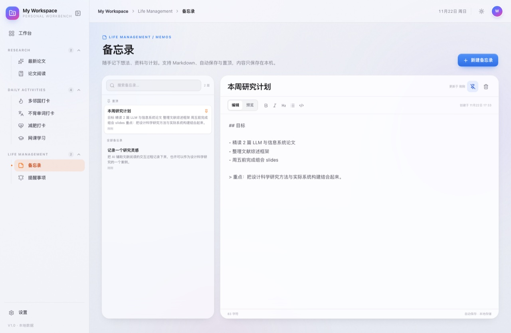 | 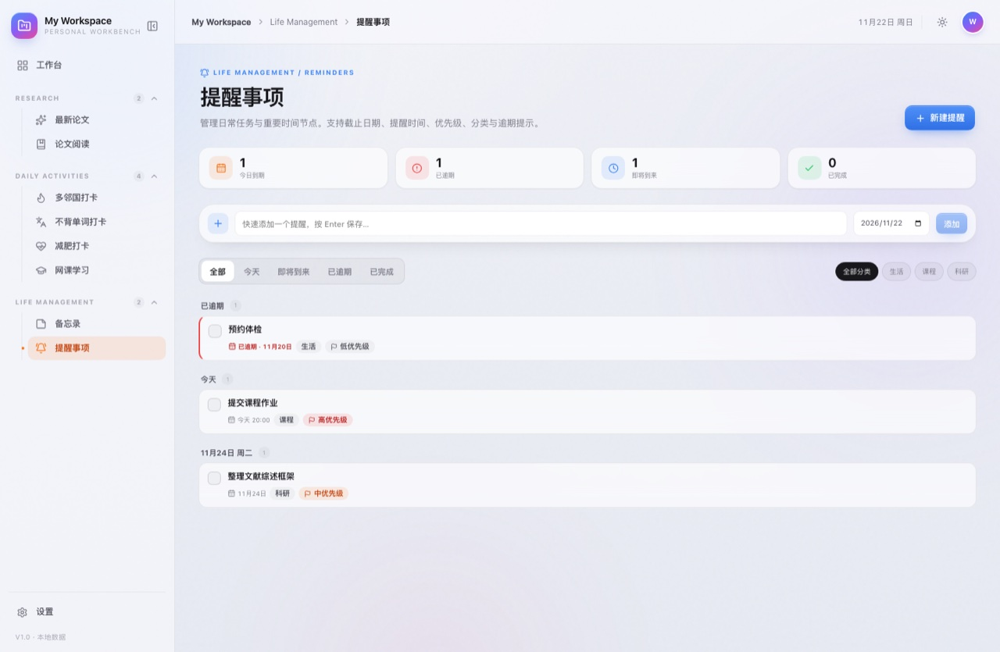 |

- 备忘录：Markdown 编辑 / 预览、自动保存、置顶、搜索。
- 提醒事项：截止日期、时间、优先级、分类、逾期提示、完成归档。

---

## 5. 设置与 AI

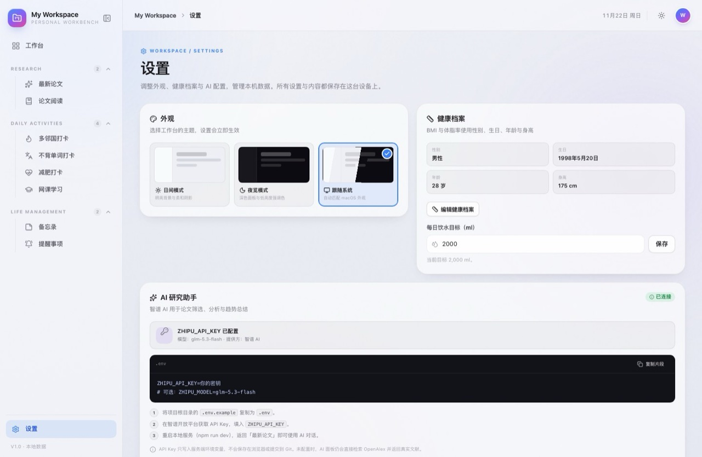

- Light / Night / 跟随系统。
- 健康档案摘要与编辑。
- 智谱 AI 配置状态、模型与 `.env` 说明。
- 本地数据统计与 JSON 导出备份。

---

## 核心特性

- 文件夹抽取 / 展开的桌面工作台体验
- 毛玻璃视觉、双主题、流畅过渡动画
- 真实 OpenAlex 学术检索与智谱 AI 工具调用
- PDF 高亮批注、阅读进度与多格式文档阅读
- 月历打卡、健康趋势、课程笔记与学习日历
- 本地 SQLite 持久化，无登录、无云端依赖
- 桌面优先，同时适配平板与手机

## 运行

```bash
npm install
cp .env.example .env   # 可选：填入 ZHIPU_API_KEY
npm run dev
```

打开 <http://localhost:5173>。

更多说明见 [README.md](README.md)、[PRD.md](PRD.md) 与 [TECHNICAL_DESIGN.md](TECHNICAL_DESIGN.md)。
